<div align="center">

<picture>
  <source media="(prefers-color-scheme: dark)" srcset="https://raw.githubusercontent.com/yasaiiko/disposable-list-audit/main/.github/banner-dark.svg">
  
</picture>

<br>

[](.github/workflows/audit.yml)
[](https://github.com/yasaiiko/disposable-list-audit/commits/main)
[](LICENSE)
[](audit.mjs)

**Your blocklist catches throwaway inboxes. Does it also catch Outlook users and Apple Hide My Email?**

[Results](#results) · [Allowlists](#allowlists-cc0) · [Use it](#use-it) · [Method](#method)

</div>

---

Open disposable-email blocklists are great at stopping throwaway inboxes. Some of them also list **mainstream mailbox providers** and **privacy relays** (Apple Hide My Email, DuckDuckGo, Firefox Relay, SimpleLogin, Proton Pass, addy.io), which forward to an inbox a real person reads. Block them and you turn away careful, often paying, users.

This repo tests the popular lists for those false positives **every Monday**, and publishes two small CC0 allowlists you can apply on top of whichever list you use.

## Results

<!-- results:start -->
Last run: **2026-11-09**. 28 mainstream providers and 14 privacy-relay domains checked.

| List | Domains | Mainstream providers listed | Privacy relays listed |
|---|---:|---|---|
| [las-nish/disposable-emails](https://github.com/las-nish/disposable-emails) | 180,561 | **12** (outlook.com, hotmail.com, live.com, msn.com, proton.me, protonmail.com, pm.me, tutanota.com, tuta.io, qq.com, 163.com, naver.com) | **14** (privaterelay.appleid.com, duck.com, mozmail.com, relay.firefox.com, simplelogin.com, simplelogin.co, slmail.me, aleeas.com, passmail.net, passinbox.com, addy.io, anonaddy.com, anonaddy.me, 33mail.com) |
| [ivolo/disposable-email-domains](https://github.com/ivolo/disposable-email-domains) | 121,569 | 0 | **1** (33mail.com) |
| [Propaganistas/Laravel-Disposable-Email](https://github.com/Propaganistas/Laravel-Disposable-Email) | 98,626 | 0 | 0 |
| [FGRibreau/mailchecker](https://github.com/FGRibreau/mailchecker) | 57,702 | 0 | **13** (duck.com, mozmail.com, relay.firefox.com, simplelogin.com, simplelogin.co, slmail.me, aleeas.com, passmail.net, passinbox.com, addy.io, anonaddy.com, anonaddy.me, 33mail.com) |
| [wesbos/burner-email-providers](https://github.com/wesbos/burner-email-providers) | 27,277 | 0 | **4** (duck.com, anonaddy.com, anonaddy.me, 33mail.com) |
| [disposable-email-domains/disposable-email-domains](https://github.com/disposable-email-domains/disposable-email-domains) | 10,181 | 0 | 0 |
| [7c/fakefilter](https://github.com/7c/fakefilter) | 4,803 | 0 | 0 |
<!-- results:end -->

> [!NOTE]
> This measures **list membership only**, not how often relays are used for abuse. Blocking relays can be a deliberate policy; the point is to make it a choice, not a side effect of the list you picked.

## Allowlists (CC0)

| File | Contents |
|---|---|
| [`relays.txt`](relays.txt) · [`relays.json`](relays.json) | Privacy-relay domains that forward to a real inbox |
| [`providers.txt`](providers.txt) · [`providers.json`](providers.json) | Mainstream mailbox providers that should never be on a disposable list |

<details>
<summary><b>Relay domains by service</b></summary>

<br>

| Service | Domains |
|---|---|
| Apple Hide My Email | `privaterelay.appleid.com` |
| DuckDuckGo Email Protection | `duck.com` |
| Firefox Relay | `mozmail.com`, `relay.firefox.com` |
| SimpleLogin | `simplelogin.com`, `simplelogin.co`, `slmail.me`, `aleeas.com` |
| Proton Pass | `passmail.net`, `passinbox.com` |
| addy.io (formerly AnonAddy) | `addy.io`, `anonaddy.com`, `anonaddy.me` |
| 33mail | `33mail.com` |

SimpleLogin and addy.io also let users bring their own domain, so a relay address can come from any domain. These lists cover the shared ones.

</details>

## Use it

Check the allowlist **before** your blocklist:

<table>
<tr><th>JavaScript</th><th>Python</th></tr>
<tr>
<td>

```js
import relays from './relays.json' with { type: 'json' };
import providers from './providers.json' with { type: 'json' };

const allow = new Set([...relays, ...providers]);

function isDisposable(email, blocklist) {
  const domain = email.split('@').pop().trim().toLowerCase();
  if (allow.has(domain)) return false;
  return blocklist.has(domain);
}
```

</td>
<td>

```python
import json

allow = set(json.load(open("relays.json"))) \
      | set(json.load(open("providers.json")))

def is_disposable(email: str, blocklist: set[str]) -> bool:
    domain = email.rsplit("@", 1)[-1].strip().lower()
    return domain not in allow and domain in blocklist
```

</td>
</tr>
</table>

## Method

[`audit.mjs`](audit.mjs) downloads each list from its default branch, normalises it (lowercase, comments and blanks removed; JSON arrays, objects and comma-separated lines supported) and checks exact membership of every domain in `providers.json` and `relays.json`. It writes [`results.json`](results.json) and the table above. A [GitHub Action](.github/workflows/audit.yml) runs it every Monday and commits any change.

```sh
node audit.mjs   # Node 18+, no dependencies
```

Know a relay, a provider or a list that should be here? Open an issue or a PR.

## More from Vetto

| | |
|---|---|
| [**better-auth-vetto**](https://github.com/yasaiiko/better-auth-vetto) | Better Auth plugin: offline blocklist, relays allowed by default |
| [**supabase-vetto-hook**](https://github.com/yasaiiko/supabase-vetto-hook) | Supabase Auth hook that blocks disposable and dead-domain signups |
| [**nextjs-vetto-example**](https://github.com/yasaiiko/nextjs-vetto-example) | Next.js form with browser + Server Action checks |
| [**Full write-up ↗**](https://usevetto.com/disposable-email-list-test) | The same study with more context |

## License

Data and code: public domain under [CC0 1.0](LICENSE). The lists being tested belong to their authors under their own licenses; this repo only stores membership results. Maintained by the maker of [Vetto](https://usevetto.com); the allowlists don't depend on it.
